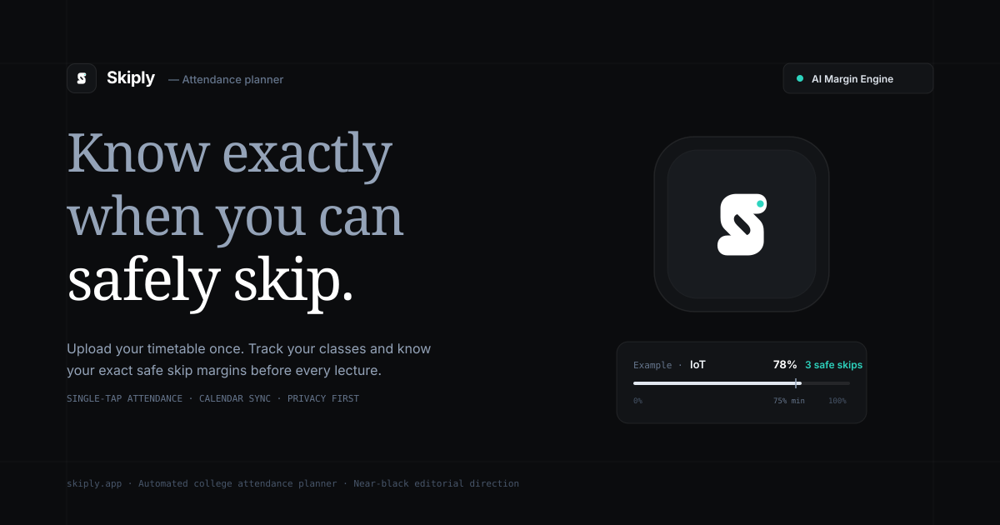
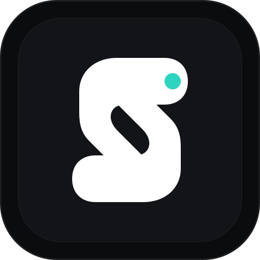
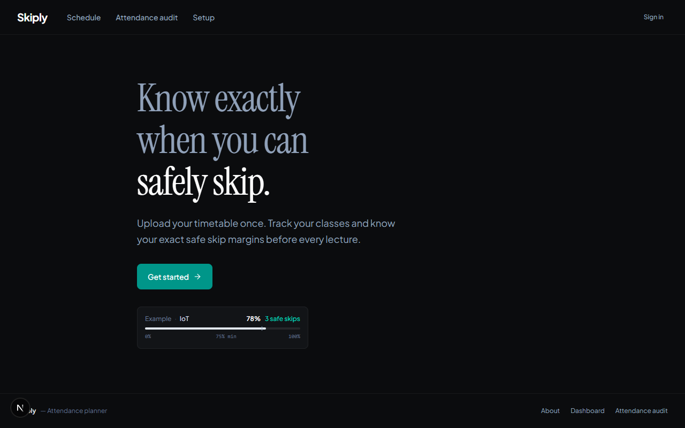
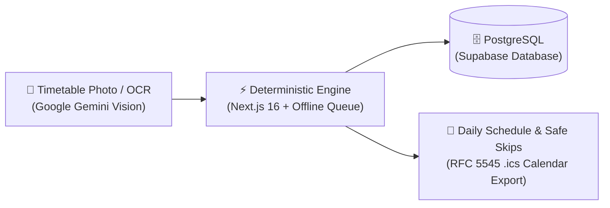

<p align="center">
  
</p>

<div align="center">

#  Skiply

**Know exactly when you can safely skip.**

*A client-first, deterministic attendance safety margin planner designed for university and college students.*

<br/>

[](https://skiply-kk.vercel.app/)
[](https://nextjs.org/)
[](https://react.dev/)
[](https://www.typescriptlang.org/)
[](https://tailwindcss.com/)
[](https://supabase.com/)
[](https://deepmind.google/technologies/gemini/)
[](LICENSE)

</div>

---

## 🌐 Live Demo

Experience the live production application deployed on Vercel:

<p align="center">
  <a href="https://skiply-kk.vercel.app/" target="_blank">
    
  </a>
</p>

<p align="center">
  <strong>Live Application:</strong>
  <a href="https://skiply-kk.vercel.app/">skiply-kk.vercel.app</a>
</p>

---

## 📖 Overview

Every college student with mandatory attendance rules (typically 75% or 80%) asks the same question:

> *"Can I safely skip today's lecture without dropping below my attendance criteria?"*

Conventional attendance apps only show past percentages ($\frac{\text{Attended}}{\text{Conducted}}$). They leave you to mentally calculate remaining lectures, semester end dates, and safe thresholds.

**Skiply solves this with an intelligent, deterministic margin engine.**

By modeling your academic timetable, holidays, and semester timeline, Skiply calculates **the exact number of lectures you can safely skip** while guaranteeing you finish at or above your target percentage.

```text
Traditional Trackers:  "You have attended 14 of 18 classes (77.8%)."
Skiply Engine:         "You can safely skip 3 more classes this semester. 
                        Target: 75% min · Status: Safe."
```

---

## ✨ Key Capabilities

| Capability | Engineering Highlight |
| :--- | :--- |
| 📐 **Deterministic Margin Engine** | Exact discrete arithmetic for safe skips and deficit recovery. Zero guessing. |
| 📸 **Optical Schedule Extraction** | Upload a photo of your timetable. Google Gemini Vision automatically extracts subjects, timings, and rooms. |
| ⚡ **Single-Tap Logging** | Log Present, Absent, Cancelled, or Swapped with one tap. Margins update instantaneously. |
| 📶 **Offline-First Resilience** | Queues actions locally in lecture halls with spotty connectivity and auto-syncs when back online. |
| 📅 **RFC 5545 `.ics` Export** | Sync your timetable with Apple Calendar, Google Calendar, and Microsoft Outlook. |
| 📱 **Tactile PWA Architecture** | Dynamic viewport scaling (`dvh`), spring physics, matched icon weights, and safe-area clearance. |
| 🎨 **Editorial Flat Aesthetic** | Flat near-black (`#0B0C0E`) palette with disciplined `teal-400` accents and Instrument Serif typography. |

---

## 📸 Visual Walkthrough

<div align="center">

### Desktop Experience
*Restrained editorial craft with instant attendance telemetry and interactive target sliders.*



<br/><br/>

### Mobile PWA Experience
*Single-thumb ergonomic daily navigation, safe skip badges, and architectural bottom sheet modals.*

<table align="center">
  <tr>
    <td align="center" width="33%">
      
      <br/><b>Daily Schedule & Safe Skips</b>
    </td>
    <td align="center" width="33%">
      
      <br/><b>Campus Student ID Auth</b>
    </td>
    <td align="center" width="33%">
      
      <br/><b>Architecture & Creators Sheet</b>
    </td>
  </tr>
</table>

</div>

---

## 🧠 How Safe Skips Work

Skiply calculates your safe skip margin using discrete arithmetic implemented in [`src/lib/math-engine.ts`](src/lib/math-engine.ts):

$$\text{Safe Skips} = \left\lfloor N_{\text{total}} \times (1 - T) \right\rfloor - \text{Absences}$$

- **$N_{\text{total}}$**: Total semester classes (conducted so far + scheduled classes remaining until the semester end date).
- **$T$**: Your attendance target (e.g. $0.75$ for $75\%$).
- **Cancelled Sessions**: Automatically deducted from conducted classes so you are never penalized.
- **Academic Holidays**: Excluded from remaining class counts using your university holiday schedule.

```text
Status Classification:
  🟢 SAFE      ·  Safe Skips > 2  (Comfortable buffer above target)
  🟡 WARNING   ·  Safe Skips 0–2  (Border zone; any skip reduces margin to zero)
  🔴 DANGER    ·  Deficit        (Below target; displays exact classes needed to recover)
```

---

## 🏗️ System Architecture



---

## 🛠️ Technology Stack

| Layer | Technologies | Purpose |
| :--- | :--- | :--- |
| **Framework** | **Next.js 16 (App Router)** | Server Components, Server Actions, streaming SSR, dynamic routing |
| **Frontend** | **React 19** | Concurrent rendering, `useTransition`, server actions integration |
| **Styling** | **Tailwind CSS v4** | Pure flat design system, hairline borders, zero CSS runtime overhead |
| **Animation** | **Framer Motion 12** | Strict `<LazyMotion>` with `domAnimation`, spring physics gestures |
| **Database** | **Supabase (PostgreSQL)** | Row-Level Security (RLS), relational timetable slots, attendance logs |
| **Auth** | **Supabase SSR** | Cookie-based session validation via `proxy.ts` middleware |
| **AI / OCR** | **Google Gemini 2.0 Flash** | Optical character recognition & structured JSON extraction for schedules |
| **Offline Sync** | **Custom Offline Queue** | Automatic FIFO queuing with `navigator.onLine` reconnection flushing |
| **PWA** | **Serwist & Service Worker** | Offline caching, standalone app manifest, mobile installability |
| **Export** | **RFC 5545 iCalendar** | Cross-platform calendar synchronization (.ics generation) |
| **Deployment** | **Vercel** | Edge runtime, global CDN distribution, automatic CI/CD deployment |

---

## 📁 Repository Structure

```text
Skiply/
├── public/                     # Static assets, branding & icons
│   ├── banner.svg              # Scalable vector banner
│   ├── icon.svg                # Minimal Forward Skip vector mark
│   ├── logo.svg                # Primary brand lockup
│   ├── manifest.json           # PWA web app manifest
│   └── screenshots/            # Verified visual proof assets
├── src/
│   ├── actions/
│   │   ├── auth.ts             # Server actions for student registration & login
│   │   └── db.ts               # Database CRUD: profiles, timetable, attendance logs
│   ├── app/
│   │   ├── about/              # Editorial about page & creators credits
│   │   ├── api/
│   │   │   └── extract-schedule/ # Gemini Vision AI extraction route
│   │   ├── dashboard/          # Daily schedule, single-tap logging & hero widget
│   │   ├── history/            # Attendance audit table, 3-dot telemetry
│   │   ├── login/              # Campus Student ID authentication
│   │   ├── onboarding/         # Timetable image upload & verification wizard
│   │   ├── layout.tsx          # Root layout, PWA meta, RubberBandContainer
│   │   └── page.tsx            # Editorial landing page & safe skip preview
│   ├── components/
│   │   ├── layout/
│   │   │   ├── navbar.tsx      # Responsive desktop & mobile header
│   │   │   ├── bottom-nav.tsx  # Fixed mobile 3-tab navigation + actions sheet
│   │   │   └── footer.tsx      # Desktop-only editorial footer
│   │   └── ui/                 # Reusable animated UI elements & icons
│   ├── features/               # Modular domain feature slices
│   │   ├── dashboard/          # DailyClassList, ClassCard, HeroWidget
│   │   ├── history/            # HistoryView, monthly audit calendars
│   │   └── onboarding/         # OnboardingWizard, schedule review steps
│   ├── lib/
│   │   ├── math-engine.ts      # Deterministic safe skip calculation engine
│   │   ├── supabase/           # Server, client, and proxy SSR clients
│   │   └── utils/              # Performance tiers, offlineQueue, cn helper
│   └── types/                  # TypeScript data contracts & database models
├── DESIGN.md                   # Single Source of Truth design system
├── PRODUCT.md                  # Product specifications & principles
└── package.json                # Project dependencies & scripts
```

---

## 🚀 Getting Started

### Prerequisites

- **Node.js**: `v20.x` or later
- **npm** or **pnpm**
- **Supabase project**: A PostgreSQL instance with the schema applied
- **Google Gemini API Key**: For AI timetable optical character extraction

### Installation

1. **Clone the repository:**
   ```bash
   git clone https://github.com/Yash4305d-y/Skiply.git
   cd Skiply
   ```

2. **Install dependencies:**
   ```bash
   npm install
   ```

3. **Configure Environment Variables:**
   Create a `.env.local` file in the project root:
   ```env
   # Supabase Configuration
   NEXT_PUBLIC_SUPABASE_URL=https://your-project.supabase.co
   NEXT_PUBLIC_SUPABASE_ANON_KEY=your-supabase-anon-key

   # Google Gemini API (AI Timetable Extraction)
   GEMINI_API_KEY=your-gemini-api-key
   ```

4. **Initialize Database Schema:**
   Execute the migration SQL file located at [`supabase-schema.sql`](supabase-schema.sql) in your Supabase SQL Editor to establish tables, relationships, and Row-Level Security (RLS) policies.

5. **Start Development Server:**
   ```bash
   npm run dev
   ```
   Open [http://localhost:3000](http://localhost:3000) in your browser.

---

## 👥 Built By

Skiply is an open-source collaboration designed and built by:

<table align="center">
  <tr>
    <td align="center" width="50%">
      <a href="https://github.com/Yash4305d-y">
        
      </a>
      <br/>
      <b>Yash Vinay Kalyani</b>
      <br/>
      <sub>Frontend Architecture · Attendance Logic · UI/UX System</sub>
      <br/><br/>
      <a href="https://github.com/Yash4305d-y">
        
      </a>
      <a href="https://yashkalyani.vercel.app/">
        
      </a>
    </td>
    <td align="center" width="50%">
      <a href="https://github.com/kyush02">
        
      </a>
      <br/>
      <b>Kyush Kumar</b>
      <br/>
      <sub>Original Concept · Product Direction · Database Schema</sub>
      <br/><br/>
      <a href="https://github.com/kyush02">
        
      </a>
      <a href="https://kyush-portfolio.vercel.app/">
        
      </a>
    </td>
  </tr>
</table>

---

## 🤝 Contributing

We welcome community contributions, feature ideas, and architectural enhancements.

1. Fork the repository.
2. Create your feature branch (`git checkout -b feat/attendance-analytics`).
3. Commit your changes following [Conventional Commits](https://www.conventionalcommits.org/) (`git commit -m "feat: add semester attendance forecasting"`).
4. Push to the branch (`git push origin feat/attendance-analytics`).
5. Open a Pull Request for review.

---

## 📄 License

Distributed under the **MIT License**. See [`LICENSE`](LICENSE) for full details.

---

<div align="center">

**Plan Your Attendance. Skip Smarter.**

[🌐 Launch Live App](https://skiply-kk.vercel.app/) · [🐛 Report Bug](https://github.com/Yash4305d-y/Skiply/issues/new?labels=bug) · [💡 Request Feature](https://github.com/Yash4305d-y/Skiply/issues/new?labels=enhancement)

</div>
