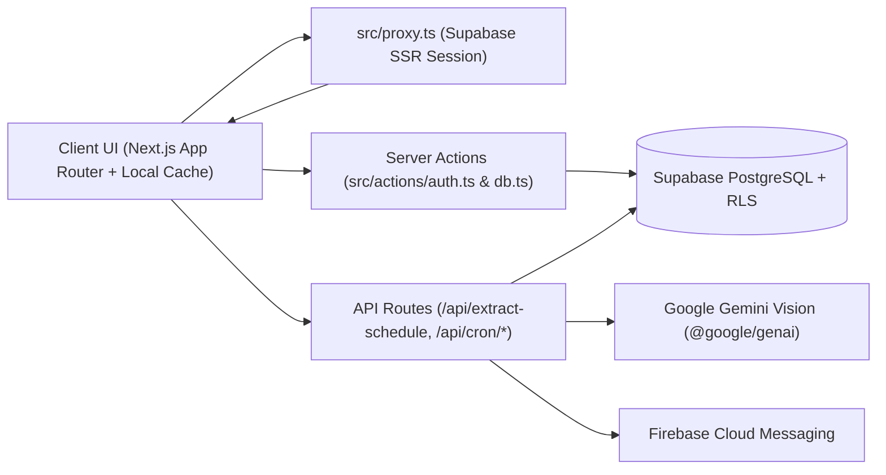

# Skiply System Architecture

This document maps all routes, authentication flows, Server Actions, API endpoints, offline synchronization, and push notification pipelines in **Skiply**.

---

## 1. High-Level Data Flow

---

## 2. App Router Pages (`src/app/`)

| Route | File | Rendering | Purpose |
| :--- | :--- | :--- | :--- |
| `/` | [`src/app/page.tsx`](../src/app/page.tsx) | `async` Server Component (`ƒ`) | Editorial landing page. Resolves `getCurrentUser()` on the server and routes the CTA to `/dashboard` or `/login`. |
| `/login` | [`src/app/login/page.tsx`](../src/app/login/page.tsx) | Client Component (`○`) | Campus Username / Student ID sign-in and registration. |
| `/onboarding` | [`src/app/onboarding/page.tsx`](../src/app/onboarding/page.tsx) | Protected (`○`) | 4-step `OnboardingWizard`: semester dates, timetable/calendar photo upload, AI OCR review, and confirmation. |
| `/dashboard` | [`src/app/dashboard/page.tsx`](../src/app/dashboard/page.tsx) | Protected (`○`) | Daily Schedule view: `HeroWidget` (overall metrics + target slider), `DailyClassList`, single-tap attendance logging, and `AttendanceReminder`. |
| `/history` | [`src/app/history/page.tsx`](../src/app/history/page.tsx) | Protected (`○`) | Attendance Audit view (`HistoryView` + `TableAuditView`): subject breakdown, monthly 3-dot calendar, and virtualized log table. |
| `/calendar` | [`src/app/calendar/page.tsx`](../src/app/calendar/page.tsx) | Protected (`○`) | Calendar route. |
| `/about` | [`src/app/about/page.tsx`](../src/app/about/page.tsx) | Static (`○`) | Editorial About page with open-source specs and creator credits. |

> **Note:** `DashboardPage` and `HistoryPage` import their core views (`HeroWidget`, `DailyClassList`, `AttendanceReminder`, `HistoryView`, `TableAuditView`) statically rather than with `next/dynamic({ ssr: false })` to avoid sequential chunk fetch waterfalls on mobile networks.

---

## 3. Authentication & SSR Session Proxy (`src/proxy.ts`)

Skiply uses **Next.js 16 `proxy.ts`** instead of legacy `middleware.ts`:
- [`src/proxy.ts`](../src/proxy.ts) exports `proxy(request)` and a `matcher` excluding `_next/static`, `_next/image`, `favicon.ico`, and static image extensions.
- [`src/lib/supabase/proxy.ts`](../src/lib/supabase/proxy.ts) (`updateSession`):
  1. Creates a Supabase SSR client using `NEXT_PUBLIC_SUPABASE_URL` and `NEXT_PUBLIC_SUPABASE_ANON_KEY`. (If credentials are unconfigured, checks are skipped cleanly.)
  2. Calls `supabase.auth.getUser()` to refresh cookies.
  3. **Protected routes** (`/dashboard`, `/calendar`, `/history`, `/onboarding`): unauthenticated users are redirected to `/login?redirect=<path>`.
  4. **Auth routes** (`/login`, `/register`, `/signup`): authenticated users are redirected to `/dashboard`.

### Virtual Email Student ID Auth ([`src/actions/auth.ts`](../src/actions/auth.ts))
Students log in with a **Username / Student ID** (not a personal email):
- `getVirtualEmail(username)` sanitizes the ID (`[a-z0-9-_]`) into `<sanitized>.skiply.app@gmail.com`.
- `signUpWithUniqueId` / `signInWithUniqueId` authenticate against Supabase Auth using that virtual email + password (minimum 6 characters) and redirect to `redirectTo` (default `/dashboard`).
- `getCurrentUser()` returns `{ id, unique_id, full_name, email }` merged from Supabase Auth and the `profiles` table.
- `signOut()` clears the session and redirects to `/login`.

> **Important Navigation Rule:** `Navbar` and `BottomNav` must **never** call `e.preventDefault()` on `<NextLink>` clicks based on an async `isLoggedIn` state. Doing so makes nav tabs unresponsive while `getCurrentUser()` is in flight. Route protection is enforced by `src/proxy.ts`.

---

## 4. Database Server Actions (`src/actions/db.ts`)

All cloud reads/writes run through Server Actions using [`src/lib/supabase/server.ts`](../src/lib/supabase/server.ts):

| Function | Purpose |
| :--- | :--- |
| `getUserProfile()` | Fetches the authenticated user's `profiles` row. |
| `updateSemesterDates(startDate, endDate)` | Updates `semester_start_date` and `semester_end_date` on `profiles`. |
| `updateSemesterConfig(targetPct, startDate, endDate)` | Updates `target_attendance_percentage` and semester dates (debounced 500ms from Dashboard slider). |
| `saveOnboardingData(payload)` | Saves semester config, subjects, timetable slots, and holidays from `OnboardingWizard`. |
| `markAttendance(payload)` | Upserts/inserts an attendance log (`PRESENT`, `ABSENT`, `CANCELLED`) for `(subjectId, timetableSlotId, logDate)`. |
| `removeAttendance(payload)` | Deletes an attendance log for `(subjectId, timetableSlotId, logDate)` (Undo action). |
| `getDailySchedule(dayOfWeek, dateStr)` | Server-side holiday + slot lookup for a given day. *(Dashboard now derives holidays locally from `getSemesterData()` via `useMemo` to avoid redundant network calls on date switches.)* |
| `getMonthAttendanceLogs(year, month)` | Fetches attendance logs scoped to a specific calendar month. |
| `getSemesterData()` | Parallel `Promise.all` fetch of `profiles`, `subjects`, `timetable_slots`, `holidays` (with `academic_holidays` fallback), and `attendance_logs`. |

---

## 5. API Routes (`src/app/api/`)

### `POST /api/extract-schedule` ([`src/app/api/extract-schedule/route.ts`](../src/app/api/extract-schedule/route.ts))
- Accepts `{ timetableImage, calendarImage, useMock }`.
- Uses `@google/genai` (Google Gemini Vision) with a structured JSON `responseSchema` to extract `subjects`, `timetable_slots`, and `academic_holidays` with confidence scores.
- Falls back to `getMockExtractionResult()` when `useMock` is set or `GEMINI_API_KEY` is missing/short.
- Client images are downscaled before upload in `OnboardingWizard` (`max 1600px` long edge, JPEG quality `0.8`).

### `GET /api/firebase-config` ([`src/app/api/firebase-config/route.ts`](../src/app/api/firebase-config/route.ts))
- Returns public `NEXT_PUBLIC_FIREBASE_*` keys for client/service-worker FCM setup.
- Responds with `Cache-Control: public, s-maxage=86400, stale-while-revalidate=604800` for Vercel Edge caching.

### `POST /api/notifications/send` ([`src/app/api/notifications/send/route.ts`](../src/app/api/notifications/send/route.ts))
- Uses `firebase-admin` (`adminMessaging.sendEachForMulticast`) and Supabase `SUPABASE_SERVICE_ROLE_KEY` to dispatch push notifications to all `fcm_tokens` for a `userId` and cleans up invalid tokens.

### `GET /api/cron/reminders` ([`src/app/api/cron/reminders/route.ts`](../src/app/api/cron/reminders/route.ts))
- Scheduled via [`vercel.json`](../vercel.json) (`"30 16 * * *"` UTC).
- Verifies `Authorization: Bearer ${CRON_SECRET}` when `CRON_SECRET` is configured.
- Evaluates IST (`Asia/Kolkata`) time, skips weekends (`dayOfWeek === 0 || dayOfWeek === 6`), and sends attendance reminder notifications at scheduled evening hours (`18`, `20`, `22` IST) for students with pending attendance.

---

## 6. Offline-First Sync & Optimistic Updates

### Optimistic UI + Rollback ([`src/app/dashboard/page.tsx`](../src/app/dashboard/page.tsx))
1. Tapping Present / Absent / Cancelled updates `logs` state immediately (`previousLogs` snapshot saved).
2. If `!navigator.onLine` or `markAttendance` fails with a network/fetch error, the action is queued via `queueAttendanceAction()`.
3. If `markAttendance` returns a non-network server error, `logs` rolls back to `previousLogs` and displays an error toast.

### Local Offline Queue ([`src/lib/utils/offlineQueue.ts`](../src/lib/utils/offlineQueue.ts))
- Persists queued actions in `localStorage` under `skiply_offline_queue_v2`.
- Dispatches `skiply_queue_updated` whenever queue length changes.
- Automatically listens to `window.addEventListener('online', flushOfflineQueue)` to replay queued `markAttendance` calls in FIFO order and dispatches `skiply_offline_synced` when complete.
- Non-network errors (e.g., auth/row conflicts) are dropped from the queue so a single bad item cannot block future syncs.
